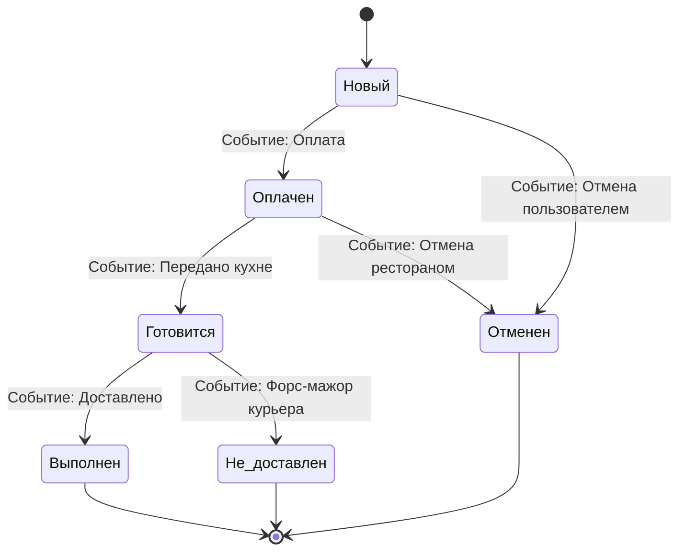

# День 10: Продвинутый тест-дизайн (Decision Table, Pairwise, State Transition)

---

## 📚 Теоретическая часть

### 1. Блок 1: Таблица принятия решений (Decision Table Testing)
При проектировании тестов для простых полей ввода достаточно базовых техник (EP и BVA). Однако в реальных ИТ-продуктах бизнес-логика часто зависит от комбинации множества условий или последовательного изменения состояний объекта. Чтобы не утонуть в **комбинаторном взрыве** и проверить сложные сценарии, применяются продвинутые техники тест-дизайна черного ящика.

**Таблица принятия решений (Decision Table Testing)** — это техника тест-дизайна, предназначенная для систем, где поведение программного обеспечения определяется сочетанием различных входных условий и бизнес-правил. Метод позволяет структурировать сложные требования и гарантировать, что ни одно сочетание факторов не было забыто.

#### 📐 Главные понятия и структура Decision Table
Таблица состоит из четырех основных квадрантов:
1. **Условия (Conditions):** Перечень всех входных факторов, флагов или параметров, которые могут повлиять на результат.
2. **Варианты условий (Condition Alternatives):** Конкретные значения или состояния для каждого условия (обычно `Y` / `N` или `True` / `False`).
3. **Действия (Actions):** Все возможные результаты, выходы или реакции системы (ошибки, скидки, переходы).
4. **Варианты действий (Action Entries):** Набор отметок (`X`), указывающий, какие именно действия выполняются при данной комбинации условий.

Каждый вертикальный столбец таблицы представляет собой **бизнес-правило (Rule)**, которое превращается в один или несколько тест-кейсов.

#### 👩‍🍳 Аналогия с рестораном
Представьте бариста в кофейне, который сверяется с условиями выдачи подарков по программе лояльности. 
- **Условия:** «Есть ли у клиента приложение?», «Является ли он VIP-гостем?», «Пришел ли он в День рождения?». 
- **Действие:** «Выдать бесплатный круассан».

Если бариста будет проверять все комбинации хаотично, он запутается. Таблица четко регламентирует: если `Приложение = Да`, `VIP = Нет`, `День рождения = Нет` ➡️ **Выдать подарок**. Если все параметры равны `Нет` ➡️ **Отказать**.

💼 **Роль QA после аналогии:** QA-инженер изучает ТЗ и строит такую таблицу, чтобы найти противоречия или забытые сценарии в требованиях еще до написания кода, структурировать комбинации бизнес-правил и проверить каждый сценарий логики без пропуска граничных условий.

#### 💡 Важные нюансы для техсобеседования
- **Индифферентность (Прочерк «-» / Don't Care):** Символ `—` означает, что конкретное условие абсолютно не влияет на итоговое действие, так как более приоритетное условие уже заблокировало или переопределило логику (например, доставка в удаленную зону всегда платная, независимо от промокодов).

---

### 2. Блок 2: Попарное тестирование (Pairwise Testing)
**Попарное тестирование (Pairwise Testing)** — это комбинаторная техника тест-дизайна, основанная на математической закономерности: абсолютное обеспечение качества достигается проверкой взаимодействия любых двух факторов в системе. Ошибки, вызываемые сочетанием трех и более параметров одновременно, встречаются на практике крайне редко.

#### 📈 Принцип работы и автоматизация
Если у системы есть 4 поля выбора с 3 вариантами значений в каждом, то для полного перебора (*Each Choice*) потребуется $3^4 = 81$ тест. Pairwise гарантирует, что в созданной матрице тестов каждое значение каждого параметра хотя бы один раз встретится в паре с каждым значением всех остальных параметров. Это сокращает количество проверок в несколько раз (из 81 теста может остаться всего 9–12).

Поскольку вручную высчитывать такие матрицы математически сложно, QA-инженеры используют специализированные утилиты генерации, такие как **Microsoft PICT** (*Pairwise Independent Combinatorial Testing*).

#### 👩‍🍳 Аналогия с рестораном
Бренд-шеф ресторанной сети создает новое меню бургеров. Есть 3 вида булочек (бриошь, картофельная, ржаная), 3 вида котлет (фермерская говядина, курица, фалафель) и 3 вида соусов (фирменный, тар-тар, горчичный). 

Полный перебор — это 27 разных бургеров. Чтобы повара на кухне не сошли с ума при дегустации, шеф использует Pairwise: он составляет меню так, чтобы бриошь успела побывать в паре и с говядиной, и с курицей, и с фалафелем, а фирменный соус пересекся с каждым типом котлет. В итоге дегустируется всего 9 бургеров, но все ключевые вкусовые сочетания пар будут проверены.

💼 **Роль QA после аналогии:** QA-инженер выбирает оптимальный баланс между временем и покрытием. Он подготавливает входные данные для генераторов (например, PICT), задает правила бизнес-ограничений (*Constraints*) и формулирует лаконичный набор комбинаций, экономя время команды при сохранении высокого качества проверки.

#### 💡 Важные нюансы для техсобеседования
- **Учет ограничений (Constraints):** В реальных системах существуют логические запреты (например, *«Самовывоз невозможно выбрать с оплатой Наличными курьеру»*). В инструментах вроде PICT QA-инженер обязан явно прописывать эти правила-исключения через синтаксис Constraints, иначе сгенерируются невалидные тесты.

---

### 3. Блок 3: Тестирование перехода состояний (State Transition Testing)
**Тестирование перехода состояний (State Transition Testing)** — это техника, применяемая для систем, поведение которых зависит не только от текущих входных данных, но и от предыдущей истории объекта (его текущего состояния). Объект переходит из одного состояния в другое только под воздействием определенных событий.

#### 🔄 Компоненты State Transition
1. **Состояние (State):** Статичное положение, в котором объект находится и ждет события (например, заказ *Новый*, *Оплачен*, *Доставлен*).
2. **Переход (Transition):** Сам процесс смены одного состояния другим.
3. **Событие (Event / Trigger):** Внешнее или внутреннее действие, которое инициирует переход (например, клик по кнопке «Оплатить», успешный коллбэк от платежной системы).
4. **Действие (Action):** Ответная реакция системы на переход (отправка Viber/Telegram-уведомления или SMS пользователю).

Результатом проектирования становится **Диаграмма переходов состояний (State Transition Diagram)** или матрица, где проверяются как валидные переходы, так и попытки нарушить логику (невалидные переходы).

#### 👩‍🍳 Аналогия с рестораном
Управляющий мясного ресторана отслеживает жизненный цикл стейка. У блюда есть последовательные состояния: *Заказан* (ожидает чека), *Готовится* (на гриле), *Подан гостю* и *Списан / В отходах*.

Если стейк находится в состоянии *Заказан* и происходит событие «Официант передал чек на кухню», стейк переходит в состояние *Готовится*. Когда повар заканчивает прожарку (событие «Блюдо готово»), статус меняется на *Подан гостю*.

Однако если стейк находится в состоянии *Заказан*, а гость через секунду пытается совершить невалидный переход — нажать *«Оформить возврат денег за съеденное блюдо»*, система кухни выдает ошибку. Вернуть деньги за съеденное можно только через процедуру рекламации из состояния *Подан гостю*, но никак не перескочить этап готовки. Задача QA — проверить все правильные шаги приготовления блюда и убедиться, что система блокирует невозможные логические прыжки (например, подать гостю стейк, который еще даже не был заказан).

💼 **Роль QA после аналогии:** QA-инженер моделирует не только штатное поведение объекта (счастливый путь / *Happy Path*), но и целенаправленно проверяет негативные сценарии — попытки совершить недопустимые/невалидные переходы из текущего состояния (например, отменить доставленный заказ или дублировать оплату).

#### 💡 Важные нюансы для техсобеседования
- **Покрытие негативных переходов:** Проверка только правильной цепочки состояний (*Valid Transitions*) дает недостаточное покрытие. Полноценное тестирование по State Transition обязательно включает проверку запрещенных переходов (*Invalid Transitions*) и корректность обработки ошибок системой при попытке их совершить.

---

## 🛠️ Практическая часть

В качестве практической работы за День 10 был проведен расчет продвинутого тест-дизайна для сервиса доставки еды.

### Шаг 1: Таблица принятия решений (Decision Table) для расчета стоимости доставки (в грн)

#### Техническое задание (ТЗ)
Базовая стоимость доставки по городу составляет **80 грн**. Доставка становится бесплатной (**0 грн**), если сумма чека превышает **600 грн** ИЛИ если у пользователя применен промокод на бесплатную доставку. Однако, если адрес доставки находится в пригородной зоне (определяется как «Удаленная зона»), то доставка всегда платная (**150 грн**), независимо от промокодов и суммы чека.

#### Итоговая Decision Table

| Параметры / Условия | R-01 | R-02 | R-03 | R-04 | R-05 |
| :--- | :---: | :---: | :---: | :---: | :---: |
| **Условие 1:** Чек > 600 грн? | Y | N | Y | N | — |
| **Условие 2:** Есть промокод? | — | Y | — | N | — |
| **Условие 3:** Удаленная зона (Пригород)? | N | N | Y | Y | Y |
| **Действие:** Стоимость доставки = 0 грн | **X** | **X** | | | |
| **Действие:** Стоимость доставки = 80 грн | | | | **X** | |
| **Действие:** Стоимость доставки = 150 грн | | | **X** | | **X** |

*Примечание: Символ `—` означает индифферентность параметра (сворачивание таблицы) из-за действия более приоритетного условия.*

---

### Шаг 2: Оптимизация комбинаций попарного тестирования (Pairwise) через Microsoft PICT

#### Входные параметры формы заказа
- **Метод оплаты (3):** Apple/Google Pay, Карта на сайте, Наличные курьеру.
- **Тип доставки (2):** Курьер, Самовывоз.
- **Пакет (2):** Стандартный пластиковый, Эко-пакет (бумажный).

Полный перебор (*Each Choice*): $3 \times 2 \times 2 = 12$ комбинаций.

#### Оптимизированная Pairwise-матрица (6 тестов)

| ID Теста | Метод оплаты | Тип доставки | Пакет | Проверяемая логика пар |
| :---: | :--- | :--- | :--- | :--- |
| **P-01** | Apple/Google Pay | Курьер | Стандартный | (Apple Pay, Курьер), (Курьер, Стандартный), (Apple Pay, Стандартный) |
| **P-02** | Карта на сайте | Самовывоз | Эко-пакет | (Карта, Самовывоз), (Самовывоз, Эко), (Карта, Эко) |
| **P-03** | Наличные | Курьер | Эко-пакет | (Наличные, Курьер), (Курьер, Эко), (Наличные, Эко) |
| **P-04** | Apple/Google Pay | Самовывоз | Эко-пакет | Бесконтактная оплата + Самовывоз + Эко-пакет |
| **P-05** | Карта на сайте | Курьер | Стандартный | Оплата картой + Курьерская доставка + Стандартный пакет |
| **P-06** | Наличные | Самовывоз | Стандартный | Оплата наличными на кассе заведения при самовывозе |

---

### Шаг 3: Карта и матрица переходов состояний (State Transition) для жизненного цикла заказа еды

#### Диаграмма состояний заказа

---

#### Итоговая Государственная матрица переходов (State Transition Matrix)

| ID Теста | Текущее состояние | Событие (Триггер) | Ожидаемый результат (Новое состояние) | Тип перехода |
| :---: | :--- | :--- | :--- | :---: |
| **ST-01** | Новый | Успешный коллбэк от платежной системы | Оплачен | Валидный |
| **ST-02** | Новый | Нажатие пользователем кнопки «Отменить» | Отменен | Валидный |
| **ST-03** | Оплачен | Администратор нажал «Передать на кухню» | Готовится | Валидный |
| **ST-04** | Готовится | Курьер привез еду и нажал «Заказ выдан» | Выполнен | Валидный |
| **ST-05** | Готовится | Форс-мажор курьера / ДТП / Возврат | Не доставлен | Валидный |
| **ST-06** | Оплачен | Попытка повторно отправить API-событие «Оплата» | Блокировка дубликата, статус остаётся `Оплачен` | Невалидный |
| **ST-07** | Выполнен | Попытка пользователя нажать «Отменить заказ» | Кнопка скрыта. Ошибка: «Нельзя отменить выполненный заказ» | Невалидный |
| **ST-08** | Отменен | Попытка вызвать курьера на этот заказ | Запрос заблокирован системой распределения | Невалидный |

---

## 💼 Вопросы на собеседовании

<b>1. Что такое комбинаторный взрыв и как Таблица принятия решений помогает с ним бороться?</b>

> **Ответ:** Комбинаторный взрыв — это лавинообразный рост количества тестов при увеличении числа входных параметров. Если у нас есть 5 условий, каждое из которых имеет 2 состояния, то общее число комбинаций равно $2^5 = 32$. Таблица принятия решений позволяет визуализировать все 32 правила и применить технику сворачивания (*collapsing*): если при определенном условии остальные параметры уже не важны для результата, эти столбцы объединяются, радикально сокращая финальное число тест-кейсов без потери качества покрытия.

<b>2. Что означает прочерк («—») в строке условий Таблицы принятия решений?</b>

> **Ответ:** Прочерк (`—` или *Don't Care*) означает индифферентность параметра. Это значит, что для данного конкретного бизнес-правила значение этого условия не имеет значения, так как результат полностью определяется другими, более приоритетными условиями. Это основа техники сворачивания таблиц (*collapsing*).

<b>3. В чем заключается главный риск использования техники Pairwise Testing и когда ее применять нельзя?</b>

> **Ответ:** Главный риск — пропуск редких дефектов, которые активируются строго при одновременном совпадении трех или более конкретных условий (например, баг воспроизводится только когда `ОС = iOS` И `тип сети = LTE` И `язык = украинский`). Pairwise такую тройную комбинацию может не построить. Данную технику нельзя использовать в критически важном ПО (медицинские приборы, авиакосмические системы, банковские транзакционные системы), где требуется исключительно стопроцентный полный перебор комбинаций.

<b>4. Как обработать несовместимые параметры при генерации Pairwise-матрицы?</b>

> **Ответ:** Для этого применяются ограничения (*Constraints*). При использовании утилит вроде Microsoft PICT QA-инженер добавляет специальный блок правил (например, `IF [Тип доставки] = "Самовывоз" THEN [Метод оплаты] <> "Наличные курьеру";`), чтобы инструмент исключил заведомо невозможные комбинации из итоговой матрицы.

<b>5. В чем разница между валидными и невалидными переходами в State Transition Testing и зачем их тестировать?</b>

> **Ответ:** Валидные переходы — это предусмотренные бизнес-логикой штатные цепочки смены состояний (например, *Новый* ➡️ *Оплачен* ➡️ *Готовится*). Невалидные переходы — это действия, запрещенные правилами (например, попытка перевести заказ из состояния *Выполнен* в состояние *Отменен*). Тестирование невалидных переходов необходимо для проверки устойчивости системы, защиты от взлома, некорректных действий пользователей и гонок процессов (*Race Conditions*).

<b>6. Чем отличается тестирование с использованием State Transition от обычного тестирования по эквивалентным классам?</b>

> **Ответ:** При эквивалентном разделении реакция системы зависит только от текущих введенных данных (без учета истории). В State Transition реакция системы на одно и то же действие напрямую зависит от того, в каком состоянии объект находился до этого момента (например, нажатие кнопки «Оплатить» в состоянии *Новый* запустит эквайринг, а в состоянии *Уже оплачен* — вернет ошибку или заблокирует дубль).

