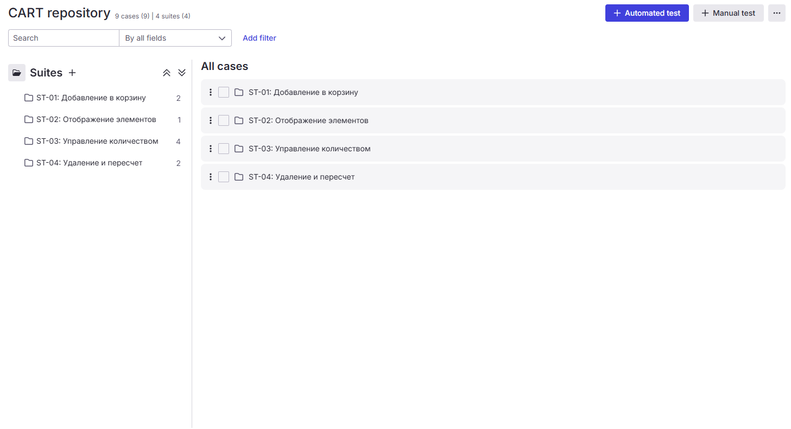

# День 11: Теория чек-листов и Матрица покрытия требований (RTM)

---

## 📚 Теоретическая часть

### 1. Блок 1: Теория чек-листов и декомпозиции в TMS Qase.io
При переходе от техник тест-дизайна к созданию тестовой документации QA-инженер сталкивается с выбором формы фиксации проверок. **Чек-лист (Checklist)** — это технический документ, содержащий структурированный список проверок (без подробных пошаговых инструкций), предназначенный для оперативного контроля качества продукта.

📐 **Главные понятия и правила составления чек-листов:**
- **Атомарность и лаконичность:** Один пункт чек-листа (чек) проверяет ровно одну законченную бизнес-идею или элемент интерфейса. Формулировка должна начинаться с глагола в инфинитиве или существительного и быть понятной любому участнику команды.
- **Иерархическая структура (декомпозиция):** Чек-листы не пишутся сплошным списком. Они разбиваются на логические разделы — **Тест-сьюты / Наборы тестов**. Декомпозиция идет от общего к частному (например: *Корзина ➡️ Добавление товара ➡️ Удаление товара ➡️ Пересчет стоимости*).
- **Предусловия (Pre-conditions):** Несмотря на лаконичность чек-листа, если для выполнения проверки требуется определенное состояние системы (например, *«Пользователь авторизован»* или *«В корзине уже есть 1 товар»*), это кратко фиксируется в описании сьюта или конкретного чека, чтобы не тратить время на подготовку окружения с нуля.
- **Независимость от тест-кейса:** В чек-листе указывается только **что** тестировать (высокоуровневая проверка), но опускается пошаговое описание **как** это делать.
- **Статусная модель:** В современных системах управления тестированием (**TMS** — *Test Management System*), таких как **Qase.io**, проверки внутри чек-листа в рамках тест-рана принимают классические статусы: `Passed` (Пройден), `Failed` (Провален), `Blocked` (Заблокирован) или `Skipped` (Пропущен).

👨‍🍳 **Аналогия со спецобувью и кухней:**
> Представьте шеф-повара, который открывает ресторан перед началом смены. Ему некогда читать 20-страничную инструкцию по эксплуатации плиты. У него в руках утренний чек-лист:
> 1. Включить вытяжную систему.
> 2. Проверить температуру в мясном цеху (целевая от +2°С до +4°С).
> 3. Проверить наличие санитарных книжек у су-шефов.
> 
> Если хотя бы один пункт не выполнен (например, вытяжка выдает ошибку), ставится статус `Failed` и запускается процесс устранения проблемы. Чек-лист спасает от человеческого фактора, когда в спешке можно забыть базовые вещи.

🛡 **Роль QA:**
QA-инженер в этой аналогии выступает в роли су-шефа или инспектора по качеству. Его задача — не просто пробежаться по пунктам перед «релизом» (открытием смены), а заранее спроектировать этот чек-лист на основе регламентов (требований ТЗ) так, чтобы учесть самые критичные точки отказа. QA следит за тем, чтобы проверки проводились системно, а в случае падения пункта — мгновенно блокирует выкат «сырого блюда» гостю (релиз пользователю) и организует устранение дефекта.

---

### 2. Блок 2: Матрица покрытия требований (Requirements Traceability Matrix — RTM)
Одним из главных рисков на проекте является ситуация, когда разработчики написали код, QA провели тесты, но при релизе выяснилось, что часть требований клиента из ТЗ просто забыли реализовать или протестировать. **Requirements Traceability Matrix (RTM)** — это двумерная таблица, которая связывает требования к продукту (из Jira / Confluence) с созданными тестовыми сценариями (чек-листами или тест-кейсами).

📈 **Задачи и преимущества применения RTM:**
1. **Контроль полноты тестового покрытия (Test Coverage):** Наглядная визуализация того, какие требования покрыты тестами на 100%, какие частично, а для каких тесты еще не написаны.
2. **Анализ влияния изменений (Impact Analysis):** Если Product Owner изменяет логику одной User Story в Jira, с помощью RTM можно мгновенно найти все чек-листы, которые требуют обновления.
3. **Исключение избыточного тестирования:** Помогает увидеть, если на одно простое требование написано 50 дублирующих проверок, и оптимизировать тестовый набор.

👨‍🍳 **Аналогия с банкетом:**
> Представьте, что VIP-гость заказывает в ресторане банкет и передает шеф-повару список своих строгих пожеланий (ТЗ/Требования):
> - Все блюда должны быть без глютена.
> - Горячее подавать ровно в 19:30.
> - В барной карте должно быть детское безалкогольное меню.
> 
> Матрица RTM в этом случае — это контрольная ведомость шеф-повара, где каждое пожелание гостя строго увязано с конкретной проверкой су-шефа перед подачей:
> * Пожелание «Без глютена» ➡️ Проверка маркировки муки на кухне (Чек #04) ➡️ Status: `Passed`.
> * Пожелание «Детское меню» ➡️ Проверка наличия детских коктейлей в барном чеке (Чек #12) ➡️ Status: `Passed`.
> * Пожелание «Подача в 19:30» ➡️ Тайминг готовности горячего цеха (Чек #18) ➡️ Status: `Not Executed`.

🛡 **Роль QA:** На основе спецификации (ТЗ в Jira) QA самостоятельно проектирует матрицу RTM, чтобы гарантировать 100% покрытие (убедиться, что разработчики не упустили ни один критерий приемки, а тестировщики подготовили проверки для каждой фичи перед выкатом) и управлять рисками изменений (если PO на лету меняет или добавляет требование, QA за минуты определяет, какие именно чек-листы устарели).

---

## 🛠️ Практическая часть

- **Контекст задачи:** Тестирование модуля «Корзина интернет-магазина».
- **Входное требование (User Story из Jira — SHOP-1 / QA-4):** *«Как авторизованный пользователь, я хочу добавлять товары в корзину и управлять их количеством, чтобы сформировать заказ»*.
- **Acceptance Criteria (Критерии приемки):**
  1. Добавление товара из карточки товара увеличивает счетчик на иконке корзины в шапке сайта на +1.
  2. Внутри корзины отображается: фото, название, цена за единицу, переключатель количества (Quantity Picker) и итоговая стоимость позиции.
  3. Лимит на количество единиц одного товара в корзине: от 1 до 10 штук включительно.
  4. При достижении лимита в 10 штук кнопка увеличения количества `+` становится неактивной.
  5. При нажатии на иконку «Удалить» (корзина) товар мгновенно исчезает из списка, а общая сумма корзины пересчитывается.

### Шаг 1: Проектирование Чек-листа (Структура для Qase.io)

| Suite (Раздел) | ID чека | Описание проверки (Что проверяем) | Предусловия / Данные | Тип проверки | Связь с требованиями (Jira ID) |
| :--- | :--- | :--- | :--- | :--- | :--- |
| **ST-01: Добавление в корзину** | CH-01 | Добавление единицы товара из каталога / карточки товара | Пользователь авторизован | Позитивная | SHOP-1.AC-1 |
| | CH-02 | Обновление счетчика товаров в шапке сайта в реальном времени | Товар добавлен | Позитивная | SHOP-1.AC-1 |
| **ST-02: Отображение элементов** | CH-03 | Наличие и корректность UI-элементов (фото, название, цена, удаление) | В корзине есть 1 товар | Позитивная | SHOP-1.AC-2 |
| **ST-03: Управление количеством** | CH-04 | Изменение количества товара кнопками + и - в диапазоне 2–9 штук | В корзине 1 товар | Позитивная | SHOP-1.AC-3 |
| | CH-05 | Проверка нижней границы переключателя: значение = 1 (кнопка - блокируется) | В корзине 1 товар | BVA (Граничная) | SHOP-1.AC-3 |
| | CH-06 | Проверка верхней границы переключателя: значение = 10 (кнопка + блокируется) | В корзине 10 товаров | BVA (Граничная) | SHOP-1.AC-4 |
| | CH-07 | Ручной ввод невалидного количества в инпут (0, 11, отрицательные, буквы) | В корзине 1 товар | Негативная (EP) | SHOP-1.AC-3 |
| **ST-04: Удаление и пересчет** | CH-08 | Удаление товара кнопкой-иконкой "Корзина" | В корзине 1 товар | Позитивная | SHOP-1.AC-5 |
| | CH-09 | Динамический пересчет "Итого" при изменении состава/количества товаров | В корзине >1 товара | Позитивная | SHOP-1.AC-2, AC-5 |

### Шаг 2: Матрица покрытия требований (Requirements Traceability Matrix — RTM)

| Код требования (Jira ID) | Описание критерия приемки (AC) | Покрывающие ID чек-листа | Статус покрытия |
| :--- | :--- | :--- | :--- |
| `SHOP-1.AC-1` | Добавление товара и обновление счетчика в шапке. | `CH-01`, `CH-02` | Покрыто полностью |
| `SHOP-1.AC-2` | Корректность UI элементов и наличие цены позиции. | `CH-03`, `CH-09` | Покрыто полностью |
| `SHOP-1.AC-3` | Управление количеством в диапазоне от 1 до 10 штук. | `CH-04`, `CH-05`, `CH-07` | Покрыто полностью |
| `SHOP-1.AC-4` | Блокировка кнопки + на максимальной границе (10 шт). | `CH-06` | Покрыто полностью |
| `SHOP-1.AC-5` | Удаление позиции и итоговый пересчет стоимости. | `CH-08`, `CH-09` | Покрыто полностью |

---

## 📁 Ссылки на экспортированные артефакты и медиа

- **📥 Выгрузка чек-листа (CSV):** [cart-checklist.csv](../exports/cart-checklist.csv)
- **📸 Скриншот структуры тест-сьютов в Qase.io:**

*Рисунок - Декомпозиция тест-сьютов ST-01-ST-04 и распределение 9 тест-кейсов в TMS Qase.io*
---

## 💼 Вопросы на собеседовании

<b>1. В чем принципиальная разница между Чек-листом и Тест-кейсом? Когда что эффективнее использовать?</b>

> **Ответ:** Главное отличие — в уровне детализации. Чек-лист содержит только краткое описание самой проверки (*«Проверить валидацию поля ввода возраста»*), а тест-кейс содержит предусловия (`Pre-conditions`), строгие пошаговые инструкции (`Steps`) и точный ожидаемый результат (`Expected Result`).
> - *Чек-листы* эффективны в условиях жесткого дефицита времени, на проектах с гибкими и быстро меняющимися требованиями (Agile/Scrum), или если тестирование проводит опытный QA, отлично знающий продукт.
> - *Тест-кейсы* незаменимы для критически важного функционала (оплата, безопасность), при передаче задач стажерам/аутсорсу, а также как основа для последующей автоматизации тестирования.

<b>2. Что делать, если во время прохождения проверки по чек-листу один из пунктов падает (Failed), но точного Ожидаемого Результата в документе нет?</b>

> **Ответ:** Несмотря на лаконичность чек-листа, критерием успешности проверки всегда является Техническое Задание (ТЗ) / User Story и здравый смысл. Если тест упал, QA-инженер обязан локализовать проблему с помощью инструментов разработчика (например, DevTools или Postman), зафиксировать фактическое аномальное поведение системы и завести баг-репорт в Jira, сославшись на конкретный пункт чек-листа.

<b>3. Зачем нужна матрица трассировки требований (RTM) и какую главную проблему она решает на проекте?</b>

> **Ответ:** Главная задача RTM — обеспечение и контроль 100% тестового покрытия (Test Coverage). Она решает проблему «забытых» или некорректно протестированных требований, позволяя прозрачно связать каждое бизнес-требование (User Story / Acceptance Criteria из Jira) с соответствующими инженерными проверками, избегая как недостаточного, так и избыточного тестирования.

<b>4. Как RTM помогает QA-инженеру при изменении требований в середине спринта (Impact Analysis)?</b>

> **Ответ:** Когда Product Owner изменяет логику или критерии приемки в User Story, QA-инженер использует RTM для проведения анализа влияния изменений (Impact Analysis). Вместо перечитывания всей тестовой документации проекта, QA находит по ID изменившегося требования конкретную строку в матрице RTM, по которой мгновенно выявляются все привязанные чек-листы и тест-кейсы, требующие немедленной актуализации.

---
