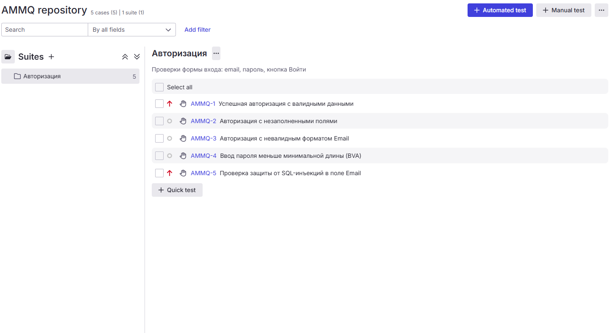
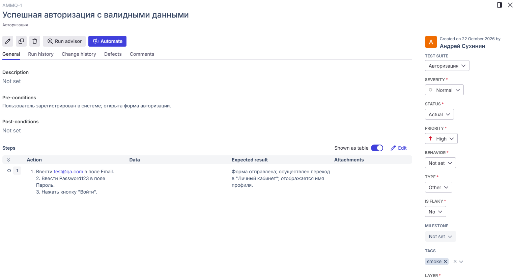
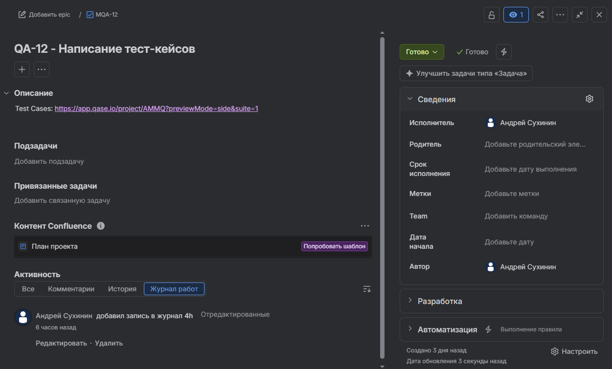

# День 12: Написание тест-кейсов и управление тестовой документацией в Qase.io

---

## 📚 Теоретическая часть

### 1. Блок 1: Анатомия Тест-кейса, Позитивное и Негативное тестирование
При переходе от лаконичных чек-листов к созданию более детализированной тестовой документации QA-инженер сталкивается с необходимостью пошагового описания проверок. **Тест-кейс (Test Case)** – это технический документ, содержащий совокупность условий, шагов и параметров, предназначенный для детальной проверки выполнения определенной функции или требования программного обеспечения.

📐 **Главные понятия и правила составления тест-кейсов:**
- **Атомарность и прозрачность:** Один тест-кейс проверяет ровно одну законченную бизнес-идею или элемент интерфейса. Формулировка названия (`Title`) должна четко отвечать на вопрос «Что проверяется?» и быть понятной любому участнику команды.
- **Пошаговая структура (`Steps`):** Содержит строгие пошаговые инструкции (алгоритм действий) в повелительном наклонении.
- **Предусловия (`Pre-conditions`):** Описание начального состояния системы и окружения (доступы, настройки, стенды), необходимого для выполнения теста.
- **Тестовые данные (`Test Data`):** Конкретные значения и параметры (email, пароли, спецсимволы), которые вводятся в систему в процессе выполнения шагов.
- **Ожидаемый результат (`Expected Result`):** Точное описание того, как система должна отреагировать на действия тестировщика согласно техническому заданию (ТЗ) или критериям приемки (`Acceptance Criteria`).
- **Постусловия (`Post-conditions`):** Действия по возвращению системы или базы данных в исходное состояние после завершения проверки.
- **Статусная модель:** В рамках выполнения тест-ранов в TMS (например, Qase.io) кейсу присваивается статус: `Passed` (Пройден), `Failed` (Упал), `Blocked` (Заблокирован) или `Skipped` (Пропущен).

⚖ **Позитивный и Негативный подходы:**
- **Позитивное тестирование (Positive Testing):** Проверка работы системы в условиях, когда вводятся валидные (корректные) данные и действия соответствуют штатному поведенческому сценарию системы. Цель: убедиться, что функция работает так, как от нее ожидает бизнес (`Happy Path`).
- **Негативное тестирование (Negative Testing):** Проверка устойчивости системы при введении невалидных данных или совершении непредусмотренных ТЗ действий (граничные значения, спецсимволы, инъекции, пустые поля). Цель: убедиться, что система корректно обрабатывает ошибки, не падает и выводит понятные пользователю валидационные сообщения.

👩‍🍳 **Аналогия с умным биометрическим замком:**
> Представьте умный биометрический замок на двери ресторана.
> - **Позитивный тест** – приложить зарегистрированный палец шеф-повара: замок должен издать приятный звук и открыть дверь.
> - **Негативный тест** – приложить палец постороннего человека, грязный предмет или попытаться ввести короткий PIN-код: замок должен остаться заблокированным, выдать красную индикацию и вывести сообщение «Доступ запрещен».

🛡 **Роль QA:**
QA-инженер выступает в качестве главного проектировщика сценариев взаимодействия пользователя с системой. Он переводит абстрактные требования ТЗ на строгий язык пошаговых инженерных инструкций. QA должен соблюдать баланс: не просто проверить «идеальный путь» разработки, а продумать изощренные негативные сценарии, чтобы защитить систему от непреднамеренных ошибок пользователей и потенциальных уязвимостей до того, как продукт попадет к реальным клиентам.

---

### 2. Блок 2: Классификация тестовых наборов (Smoke, Sanity, Regression)
По мере роста продукта количество тест-кейсов увеличивается, что требует их грамотной декомпозиции и группировки в логические разделы – **тест-сьюты** (наборы тестов) под различные цели и задачи проекта.

📈 **Задачи и особенности применения тестовых наборов:**
- **Smoke Testing (Дымовой тест):** Проверка самой критически важной функциональности («бизнес-ядра») системы после нового билда (сборки). Если Smoke-тест падает, билд признается заблокированным (`Blocked`), тестирование останавливается, а сборка возвращается разработчикам.
- **Sanity Testing (Санитарный тест / Проверка разумности):** Очень узкое, но глубокое тестирование конкретного программного модуля или функции после внесенных изменений или исправления багов. Цель – убедиться, что конкретная фича работает корректно, без проверки остальной системы.
- **Regression Testing (Регрессионное тестирование):** Масштабное тестирование уже проверенных ранее модулей системы после внесения изменений в другие части кода. Цель – убедиться, что новые фичи или исправления багов не «сломали» (не отрегрессировали) тот функционал программного обеспечения, который раньше работал стабильно.

👩‍🍳 **Аналогия с ресторанной кухней в день презентации нового меню:**
> - **Smoke Testing** – это утренняя экспресс-проверка базовой инфраструктуры кухни: включена ли вообще вытяжка, горит ли свет, подается ли газ на плиты. Если газ не идет – кухня не заведется, готовить бессмысленно, и работа всей смены останавливается.
> - **Sanity Testing** – это точечная проверка конкретного блюда, в котором шеф-повар только что изменил рецептуру (например, пересолил соус и переделал его заново). Инспектор проверяет вкус только этого измененного соуса, не дегустируя при этом остальные сто блюд из меню.
> - **Regression Testing** – это масштабная проверка всех старых, ранее проверенных блюд и технологических процессов кухни после того, как в заведение завезли новое мощное оборудование. Цель – убедиться, что новые кухонные агрегаты случайно не «выбили пробки» и не нарушили выпечку классических фирменных десертов, приготовление которых работало стабильно годами.

🛡 **Роль QA:**
В данном контексте QA-инженер берет на себя роль стратега и оптимизатора. Он не просто запускает все тесты подряд, а проводит анализ влияния изменений (`Impact Analysis`). На основе масштаба нового кода QA формирует такой тестовый набор, который обеспечивает максимальное качество покрытия при минимальных затратах времени. Если разработчик заявляет, что исправил точечный баг, QA-инженер определяет границы регрессии, защищая стабильную часть системы от случайных «откатов» и поломок старого функционала.

---

## 🛠️ Практическая часть

- **Контекст задачи:** Проектирование тест-кейсов для модуля авторизации в TMS **Qase.io** (проект `AMMQ`), интеграция с задачей в **Jira** (`QA-12`) и фиксация отчета в репозитории **Git**.
- **Тестовый набор (Suite):** `Авторизация`
- **Перечень разработанных тест-кейсов:**
  - `AMMQ-1`: Успешная авторизация с валидными данными (`smoke`, `High`)
  - `AMMQ-2`: Авторизация с незаполненными полями (`regression`, `Medium`)
  - `AMMQ-3`: Авторизация с невалидным форматом Email (`regression`, `Medium`)
  - `AMMQ-4`: Ввод пароля меньше минимальной длины (BVA) (`regression`, `Medium`)
  - `AMMQ-5`: Проверка защиты от SQL-инъекций в поле Email (`smoke`, `High`)

---

## 📁 Артефакты и скриншоты (Artifacts)

### 1. Структура сьюта и список тест-кейсов в Qase.io

*Рисунок 1 — Сьют «Авторизация» со списком 5 тест-кейсов (AMMQ-1...AMMQ-5), приоритетами и тегами*
---
### 2. Детализация тест-кейса AMMQ-1

*Рисунок 2 — Карточка тест-кейса AMMQ-1 с пошаговыми инструкциями, предусловиями и ожидаемым результатом*
---
### 3. Карточка задачи в Jira

*Рисунок 3 — Карточка задачи QA-12 в статусе Done со ссылкой на Qase.io, назначенным исполнителем и залогированным временем 4h*
---

## 💼 Вопросы на собеседовании

<b>1. В чем разница между Позитивным и Негативным тестированием? Почему нельзя ограничиваться только Позитивными проверками?</b>

> **Ответ:** Позитивное тестирование проверяет, работает ли система при вводе корректных (валидных) данных и совершении предусмотренных действий (`Happy Path`). Негативное тестирование проверяет устойчивость системы при вводе невалидных данных или совершении ошибочных действий[cite: 11].
> 
> Ограничиваться только позитивным тестированием нельзя, так как реальные пользователи часто совершают ошибки (вводят не тот формат, оставляют поля пустыми, вставляют спецсимволы)[cite: 11]. Без Негативного тестирования система может упасть с критической ошибкой (`Uncaught Error` / `500 Server Error`) или допустить уязвимость (например, SQL-инъекцию или доступ к чужим данным)[cite: 11].

<b>2. Что такое принцип атомарности тест-кейса и почему важно его соблюдать при составлении тестовой документации?</b>

> **Ответ:** Принцип атомарности означает, что один тест-кейс должен проверять строго одну конкретную атомарную функцию, правило или логический элемент интерфейса[cite: 11].
> - **Локализация ошибок:** Если длинный тест-кейс из 20 шагов падает на 3-м шаге, все остальные проверки становятся заблокированными (`Blocked`), и вы не знаете, работают ли шаги с 4 по 20[cite: 11].
> - **Экономия времени:** Атомарные тест-кейсы выполняются быстро, их легко поддерживать и актуализировать при изменении требований[cite: 11].
> - **Прозрачность отчетности:** В TMS-системе и отчетах для команды сразу видно, какая именно точка функционала сломалась, без необходимости перечитывать длинные сценарии[cite: 11].

<b>3. Что происходит на проекте, если в процессе выполнения Smoke Testing обнаруживается критический баг? Каковы дальнейшие действия QA-инженера?</b>

> **Ответ:** Если Smoke-тест (проверка критического функционала ядра) падает, сборка (`build`) считается полностью неработоспособной[cite: 11]. QA-инженер выставляет статус сборки как `Blocked` (Заблокировано), прекращает дальнейшее тестирование этого билда, чтобы не тратить время впустую, и немедленно возвращает задачу/сборку обратно разработчикам с подробным логом или баг-репортом[cite: 11]. Тестирование возобновляется только после того, как разработчики выпускают исправленный билд (`Hotfix`) и Smoke-тест успешно проходит[cite: 11].

<b>4. Как правильно определить границы (объем) регрессионного тестирования при ограниченном времени на релиз перед дедлайном?</b>

> **Ответ:** Когда времени на полный прогон всей регрессионной базы нет, QA-инженер применяет `Impact Analysis` (Анализ влияния изменений) и оценку рисков:
> - Анализируется список изменений (Git-коммиты, список закрытых задач в спринте), чтобы понять, какие модули были затронуты[cite: 11].
> - Фокус смещается на критически важные бизнес-пути (`Critical Path`) и зоны повышенного риска (модули, которые тесно связаны с измененным кодом)[cite: 11].
> - Используются приоритеты тест-кейсов (в первую очередь прогоняются кейсы с наивысшим приоритетом – `High`/`Critical`), а низкоприоритетные проверки откладываются или автоматизируются[cite: 11].

---