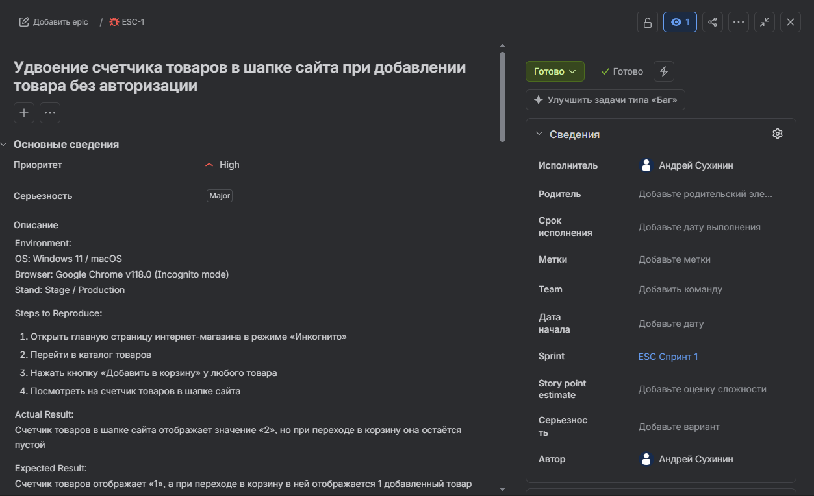
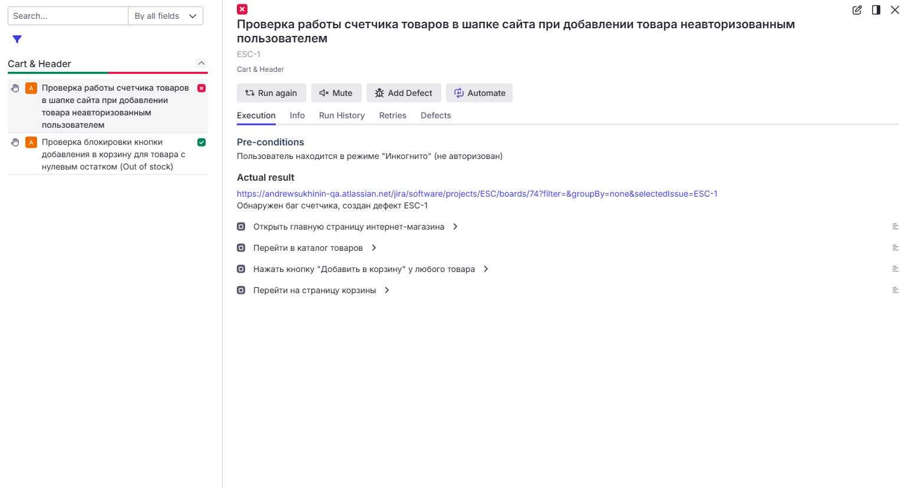
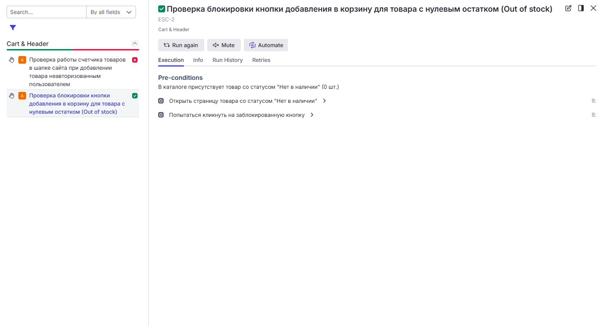

# День 13: Структура Баг-репорта, Серьезность vs Приоритет

---

## 📚 Теоретическая часть

### 1. Блок 1: Анатомия и правила составления баг-репорта
При обнаружении несоответствия фактического поведения системы ожидаемому результату QA-инженер переходит от выполнения тест-кейсов к документированию дефектов. **Bug Report (Баг-репорт)** – это технический документ, содержащий полное описание ошибки, включая информацию о причинах ее возникновения, условиях воспроизведения и степени влияния на продукт, предназначенный для передачи разработчику с целью последующего исправления.

📐 **Главные понятия и правила составления:**
- **Правило «Что? Где? Когда?» (Summary / Название):** Заголовок баг-репорта должен быть лаконичным, но максимально информативным. Он обязан отвечать на три ключевых вопроса:
  - *Что сломалось?* (Например: Удвоение счетчика / Ошибка 500 / Поле ввода блокируется).
  - *Где это произошло?* (Например: В шапке сайта / На экране авторизации / В корзине).
  - *При каких условиях / Когда?* (Например: При добавлении товара без авторизации / При клике на кнопку «Купить»).
- **Шаги воспроизведения (Steps to Reproduce - STR):** Строгая пошаговая инструкция в повелительном наклонении («Откройте», «Перейдите», «Нажмите»), которая позволяет разработчику воспроизвести дефект с чистого листа.
- **Фактический результат (Actual Result):** Точное описание того, как система ведет себя в реальности (с фиксацией артефактов, счетчиков или визуальных багов).
- **Ожидаемый результат (Expected Result):** Описание корректного поведения системы согласно техническому заданию или логике приложения (`Happy Path`).
- **Окружение (Environment):** Спецификация тестового стенда (ОС, браузер, режим инкогнито, стенд).
- **Вложения (Attachments):** Визуальные доказательства – скриншоты, логи консоли (DevTools).

---

### 2. Блок 2: Метрики качества и управления дефектами (Severity vs Priority)
QA-инженер должен уметь разделять техническую сторону дефекта и его бизнес-значимость для продукта. Для этого используются две независимые метрики:

⚖ **Ключевые метрики дефектов:**
- **Severity (Серьезность):** Характеризует техническую степень влияния дефекта на рабоспособность приложения (определяется QA-инженером).
  - *Примеры уровней:* `Blocker`, `Critical`, `Major`, `Minor` / `Trivial`.
- **Priority (Приоритет):** Указывает на очередность и срочность исправления дефекта для бизнеса (определяется Product Owner`ом или менеджером проекта).
  - *Примеры уровней:* `High`, `Medium`, `Low`.

---

## 🛠️ Практическая часть

- **Контекст задачи:** Оформление реального дефекта в Jira по результатам прогона в TMS **Qase.io** для проекта `ESC` (Интернет-магазин).
- **Инструменты:** Jira Cloud, Qase.io, Chrome DevTools.
- **Артефакты:**
  - Создан детальный баг-репорт **`ESC-1`** в Jira с корректными атрибутами (`Severity: Major`, `Priority: High`).
  - Выполнена интеграция и связка упавшего тест-кейса в Qase.io с карточкой дефекта в Jira.

---

## 📁 Артефакты и скриншоты (Artifacts)

### 1. Оформленный баг-репорт в Jira
  
*Рисунок 1 — Карточка дефекта ESC-1 в Jira с настроенным окружением, шагами воспроизведения и атрибутами Severity/Priority*
---
### 2. Результаты прогона тест-кейсов в Qase.io
  
*Рисунок 2 — Выполнение тест-кейса со статусом Failed, актуальной ссылкой и привязанным дефектом Jira (ESC-1)*
---
  
*Рисунок 3 — Успешное выполнение позитивного тест-кейса со статусом Passed*
---

## 🔗 Ссылки на внешние ресурсы (References)
- **Карточка дефекта в Jira:** [ESC-1: Удвоение счетчика товаров в шапке сайта при добавлении товара без авторизации](https://andrewsukhinin-qa.atlassian.net/jira/software/projects/ESC/boards/74?filter=&groupBy=none&selectedIssue=ESC-1)

---

## 💼 Вопросы на собеседовании

<b>1. Почему критически важно соблюдать правило заголовка «Что? Где? Когда?» при составлении баг-репорта?</b>

> **Ответ:** Заголовок (Summary) — это первое, что видит разработчик в списке задач Jira. Четкий заголовок позволяет мгновенно понять масштаб проблемы и ее суть без необходимости вчитываться в длинный текст, что значительно ускоряет триаж багов на командных встречах.

<b>2. Приведите пример дефекта с комбинацией High Severity / Low Priority.</b>

> **Ответ:** Критический сбой (падение приложения) при попытке экспортировать старый отчет за 2015 год в редком формате. Технически это падение системы (`High Severity`), но функцией никто не пользуется, поэтому бизнесу невыгодно тратить ресурсы на срочный фикс (`Low Priority`).

<b>3. В чем главное различие между Severity и Priority, и кто отвечает за выставление каждой из этих метрик?</b>

> **Ответ:** **Severity (Серьезность)** отражает технический масштаб ущерба для системы (определяет QA-инженер: падение сервера, блокировка функции, визуальный баг). **Priority (Приоритет)** определяет очередность исправления для бизнеса (определяет менеджер проекта или Product Owner, исходя из влияния на пользователей и коммерческих целей).

<b>4. Что должен содержать блок «Шаги воспроизведения» (Steps to Reproduce) в идеальном баг-репорте?</b>

> **Ответ:** Шаги должны представлять собой четкую нумерованную последовательность действий в повелительном наклонении («Откройте», «Перейдите», «Нажмите»), начиная с исходной точки (например, авторизации или перехода на главную страницу), которая гарантированно приведет к воспроизведению дефекта с «чистого листа».

